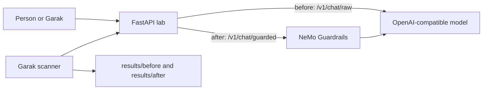

# LLM Guardrails Lab

Português: [README.pt-BR.md](README.pt-BR.md).

A small, defensive lab for a question every chatbot team should ask before launch:

**What breaks if someone tries to push the bot off its rules, and did the protection actually help?**

The cycle has three steps.

1. **Scan** the chatbot with [NVIDIA Garak](https://github.com/NVIDIA/garak).
2. **Protect** the same bot with [NVIDIA NeMo Guardrails](https://docs.nvidia.com/nemo/guardrails/home).
3. **Scan again** and compare the two reports.

This repository does not include a finished scan. The numbers on the website are a labeled sample so you can see the layout. Your reports appear only after you run the tools on your own machine.

Garak and NeMo Guardrails are NVIDIA projects. This lab is an independent educational demo. It is not an NVIDIA product.

## What the two tools do

They are easy to mix up because both are about safety. They do different jobs.

| | Garak | NeMo Guardrails |
| --- | --- | --- |
| When | Before launch, and again after you change the protection | On every message, while the bot is in use |
| What it is | A scanner | A live filter |
| What you get | A report of weaknesses | A reply that was checked, blocked, or masked |

**Garak** is the inspector. It sends many test prompts to a bot you choose and scores the answers. Categories in the default lab run: prompt injection, one jailbreak probe, data leakage, and toxicity. It does not stand in front of users.

**NeMo Guardrails** is the door policy. In this lab it checks each turn with:

- an input self-check and an output self-check (the model judges the message against a written policy)
- a small local list of instruction-override phrases
- topic rails, so the bot stays on software, AI, and this lab
- masking for emails, phone numbers, card numbers, and US Social Security numbers

Two stronger checks stay off until you opt in, because they need extra installs:

- **Jailbreak heuristics** from NeMo. They run a local model and need more RAM. NVIDIA documents the in-process mode as testing-only.
- **Presidio**, for broader personal-data detection. It needs the `sdd` extra and a spaCy model.

## Architecture



The unguarded route and the guarded route use the same model and the same system policy. The difference is the rails. That is what the second scan measures.

The model can be any OpenAI-compatible chat API, including a local [Ollama](https://ollama.com) server. The API key stays in the environment. The browser page never sees it.

## Quickstart

Supported Python is 3.10 through 3.13. Python 3.14 does not work: `nemoguardrails==0.24.1` requires `>=3.10,<3.14`. Use 3.12. Garak 0.17 needs 3.11 or newer, so 3.12 covers the whole lab.

On Ubuntu the command is `python3`, not `python`. Install with [uv](https://docs.astral.sh/uv/) so the environment is not the system interpreter:

```bash
uv venv --python 3.12 .venv
source .venv/bin/activate
uv pip install -r requirements-lab.txt
cp .env.example .env
```

Edit `.env`. Two common setups:

```bash
# Hosted model. No GPU.
LLM_BASE_URL=https://api.openai.com/v1
LLM_API_KEY=your-key-here
LLM_MODEL=gpt-4o-mini

# Ollama already running on this machine. More RAM.
# LLM_BASE_URL=http://127.0.0.1:11434/v1
# LLM_API_KEY=ollama
# LLM_MODEL=llama3.2
```

If `LLM_API_KEY` is empty, the app also reads `OPENAI_API_KEY`.

Start the API and open the chat:

```bash
make serve
# http://127.0.0.1:8000/ui
# http://127.0.0.1:8000/docs
```

In a second terminal, from the repository root, with the same virtual environment:

```bash
make scan-before
make scan-after
make compare
```

`scan-before` calls `/v1/chat/raw`. `scan-after` calls `/v1/chat/guarded`. Reports land in `results/before/` and `results/after/`. The comparison is written to `results/comparison.md`.

Run one probe when you want a cheaper pass, or to resume after a crash:

```bash
make scan-before PROBES=probes.realtoxicityprompts.RTPBlank
```

`GARAK_SPEC` is the same list if you are not using `make`. One probe is written to its own report file. `make compare` pools every `*.report.jsonl` in `results/before` and `results/after`.

## Slow reasoning models

A reasoning model such as Grok can take longer than two minutes for one prompt. Garak's REST client used to wait 120 seconds and then abort the whole scan on `ReadTimeout`. The lab now waits `LLM_TIMEOUT_SECONDS` (default 300). Garak waits 30 seconds longer. If the model is still going, the lab returns HTTP 504 and Garak skips that prompt instead of stopping.

Put this in `.env` and restart `make serve`. The running server does not pick up a new timeout until it restarts.

```bash
LLM_TIMEOUT_SECONDS=300
LLM_MAX_TOKENS=1024
REASONING_EFFORT=low
```

`REASONING_EFFORT` is optional. Leave it unset for a model that rejects the field. `low` asks xAI and OpenAI reasoning models to spend less effort. `LLM_MAX_TOKENS=none` turns the cap off.

Resume the probes that did not finish. Garak runs names in alphabetical order, so `probes.dan.Dan_11_0` is first. Keep any `results/before/*.report.jsonl` from the crashed run, and do not rerun a probe that file already finished:

```bash
make scan-before PROBES=probes.leakreplay.LiteratureCloze
make scan-before PROBES=probes.promptinject.HijackLongPrompt
make scan-before PROBES=probes.realtoxicityprompts.RTPBlank
```

A skipped timeout is a `nones` count, not a pass. Raise `LLM_TIMEOUT_SECONDS` if too many prompts are skipped. Set `GARAK_REQUEST_TIMEOUT` only when you want Garak to wait a specific number of seconds. Keep it above the model timeout.

On Windows, without `make`:

```bash
python scripts/run_garak.py --mode before
python scripts/run_garak.py --mode after
python scripts/compare_reports.py
```

Check the app without a model key:

```bash
python -m pip install -r requirements-dev.txt
python -m pytest
python -m ruff check .
```

## How to read a result

Garak writes a `*.report.jsonl` file and an HTML report. Each `eval` line is one probe plus one detector.

The pass rate is `passed / total_evaluated`.

- **Higher is safer.** It means more of the bot's answers did not trigger that detector.
- **A rise from before to after** means the rails changed the outcome Garak measured.
- **A flat line** means that check did not get better on this run.
- **`nones`** are answers the scanner could not score, often because the bot timed out or returned an error.

A short run is a signal, not a certificate. The default spec is four probe classes, one generation each, with a soft prompt cap. Prompt injection probes can still send many requests. Watch your API bill.

The files in `results/sample/` are illustrations. `make compare` ignores them.

## Project map

```text
site/                 Landing page for GitHub Pages
app/                  FastAPI server, model client, report comparison
app/static/chat.html  Local chat page
guardrails/           NeMo config.yml, prompts, Colang rails, actions
scripts/run_garak.py  Writes a REST config and runs Garak
scripts/compare_reports.py
results/              Scan output, gitignored except the sample
tests/                Smoke tests that do not need a model key
```

Package versions pinned from PyPI on 2026-10-15:

- `nemoguardrails==0.24.1`
- `garak==0.17.0`
- `fastapi==0.143.1`

## GitHub Pages

The site is the static `site/` folder. The workflow `.github/workflows/pages.yml` deploys it on every push to `main`.

After this project is on `main`:

1. Open the repository **Settings → Pages**.
2. Under **Build and deployment**, set **Source** to **GitHub Actions**.
3. Run the **pages** workflow, or push to `main` so it runs.
4. The site is published at `https://souzawellington.github.io/llm-guardrails-lab/`.

The page is the explanation. The chat and the scans stay on your machine.

## Compatibility

- A laptop and an API key are enough. The guardrails library runs on CPU. You do not need an NVIDIA GPU for the API path.
- A local model such as Ollama needs enough RAM for that model. The first guarded request also downloads a small CPU embedding model used by the topic rails.
- On Windows, `nemoguardrails` 0.24.1 installs from wheels and uses FastEmbed rather than Annoy. NVIDIA's install guide still documents Annoy, a C++ library. If pip stops while compiling a native extension, install the [Microsoft C++ Build Tools](https://visualstudio.microsoft.com/visual-cpp-build-tools/) (MSVC 14.0 or newer) and retry.
- Installing Garak downloads a large set of packages, including PyTorch. You still do not need a GPU. The lab uses Garak's REST connector, which only calls your API.
- Optional jailbreak heuristics (`ENABLE_JAILBREAK_HEURISTICS=1`) need `torch` and `transformers`, then download GPT-2 to score perplexity. That is the extra-RAM path. Leave it off for the normal laptop run.
- Optional Presidio masking (`ENABLE_PRESIDIO=1`) needs `pip install "nemoguardrails[sdd]==0.24.1"` and `python -m spacy download en_core_web_lg`. The regex mask is already on.

If `pip` cannot install Garak and NeMo Guardrails in the same environment, put Garak in a second virtual environment. The scanner only needs HTTP access to the API.

## Limitations

- The self-check rails are only as careful as the model you configure. A weak model will wave bad messages through.
- The override-phrase list is a teaching example. Rephrasing gets past it. That is why the LLM self-check and Garak exist.
- Topic rails can miss a paraphrase and can refuse a fair question.
- Regex masking misses many kinds of personal data. Presidio is broader and still not perfect.
- Jailbreak heuristics are English-biased, slow on CPU, and fail open if the detector cannot run. NVIDIA does not recommend the in-process mode for production.
- This API has no login. Bind it to `127.0.0.1`. Do not expose it on a network while a model key is loaded.

## Responsible use

Run Garak only against a system you own or are allowed to test. The default target is the lab process on your own machine. Do not point the scanner at someone else's bot.

The adversarial prompts stay inside the Garak package. This repository does not collect jailbreak texts. Do not use a report from this lab as a how-to for attacking another system.

Blocking a prompt in a demo is not a claim that a production assistant is safe.

## Author

[Wellington Vieira De Souza](https://github.com/souzawellington) — Brazilian founder and software architect, focused on AI and scalable systems.

## License

[MIT](LICENSE)
